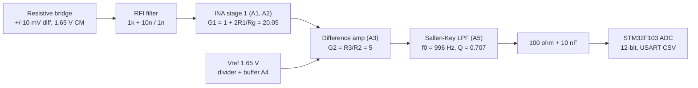
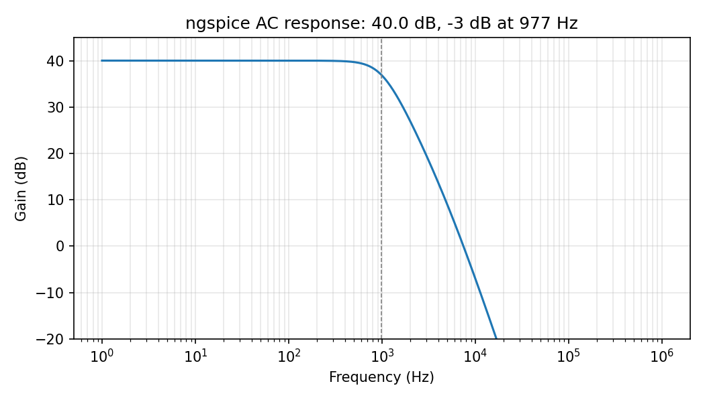
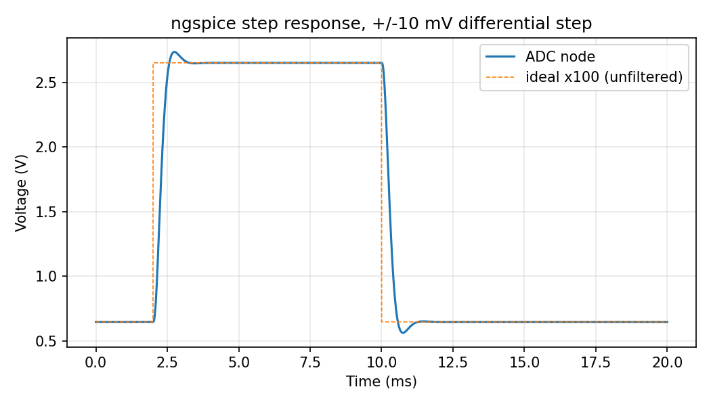
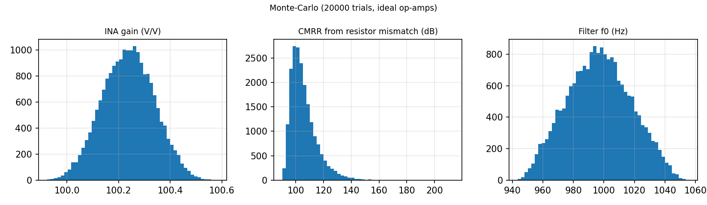

# Precision Analog Sensor Front-End: Instrumentation Amplifier + Active Filter

A single-supply (3.3 V) signal-conditioning chain for a low-level resistive bridge sensor
(+/-10 mV full scale): **3-op-amp instrumentation amplifier (G = 100) -> 2nd-order Sallen-Key Butterworth
low-pass (fc ~ 1 kHz) -> 12-bit STM32 ADC**, with hand calculations, SPICE simulation, Monte-Carlo analysis,
bench test procedure, and calibration firmware.

> **Status:** design, simulation, analysis scripts and firmware maths are complete and tested on a PC.
> Hardware results in the table below are marked **TBD** until you fill them in from your own bench measurements.

## Block diagram



## Key numbers

| Parameter | Design / prediction | Measured |
|---|---|---|
| Total gain | 100.24 V/V (40.02 dB) | TBD |
| Output range at +/-10 mV | 0.648 ... 2.652 V | TBD |
| Low-pass corner (-3 dB) | 996 Hz ideal, 977 Hz simulated (incl. input RFI filter) | TBD |
| Filter Q | 0.7071 (Butterworth) | TBD |
| Step overshoot | ~4.3 % (ngspice) | TBD |
| CMRR | median ~103 dB from resistor mismatch only (ceiling) | TBD |
| Input-referred noise | ~16.7 nV/rtHz, ~0.56 uV rms in band (assumed en = 10 nV/rtHz) | TBD |
| ADC resolution at input | 8.04 uV/count, ~2488 counts across +/-10 mV | TBD |

Prediction sources: `scripts/design_calc.py` (equations + Monte-Carlo, ideal op-amps) and `simulation/` (ngspice with a
generic op-amp macro-model). Swap in the TI TLV9064 / TLV9062 SPICE models for sign-off numbers.





## Repository layout

```
.
├── README.md
├── LICENSE                         MIT
├── docs/
│   ├── 01_design_calculations.md   every equation and design decision
│   ├── 02_test_procedure.md        bench tests T0-T7
│   ├── 03_build_guide.md           connection table, layout rules, test fixtures
│   └── images/                     plots (generated) + put your bench photos / scope captures here
├── hardware/
│   └── bom.csv
├── simulation/
│   ├── opamp_rr.lib                generic rail-to-rail op-amp macro-model
│   ├── ina_filter_full.cir         full chain: .op .ac .tran .noise + .meas (LTspice / ngspice)
│   ├── ina_filter_montecarlo.cir   100-run Monte-Carlo (LTspice only: mc())
│   └── run_ngspice.py              run in ngspice and plot
├── scripts/
│   ├── design_calc.py              design equations, E96 snapping, Monte-Carlo, noise budget
│   ├── analyze_bench.py            CSV measurements -> gain / freq / CMRR / noise / ADC error + plots
│   └── requirements.txt
├── firmware/
│   ├── Core/Inc, Core/Src          afe.[ch] (pure maths) + app.[ch] (HAL glue)
│   ├── tests/                      host unit tests (make -C firmware/tests)
│   └── README.md                   CubeIDE setup, UART commands
└── measurements/                   CSV templates for your bench data
```

## Quick start

```bash
pip install -r scripts/requirements.txt
python scripts/design_calc.py --mc 20000 --plot     # numbers + figures
make -C firmware/tests                              # firmware maths unit tests
python simulation/run_ngspice.py                    # needs ngspice installed
```
LTspice: *File > Open* `simulation/ina_filter_full.cir` (keep `opamp_rr.lib` next to it) and run. Check the
`.meas` results in *View > SPICE Output Log*. To draw it as a schematic, use *Hierarchy > Open this Netlist*-style
workflows or redraw from `docs/03_build_guide.md`, then add the screenshot to `docs/images/`.

## Design in one paragraph

Gain is split **G1 = 20 in the input stage, G2 = 5 in the difference amp**, because stage-1 gain multiplies the CMRR
of the whole chain while resistor mismatch in stage 2 limits it. A buffered divider supplies the 1.65 V mid-rail
reference, which centres the output for a single-supply ADC. The Butterworth response uses `C1 = 2*C2` with equal
resistors, C0G capacitors and E96 values (11.3 k, 10 nF/20 nF). Everything is ratiometric: bridge excitation, mid-rail
reference and ADC reference all come from the same 3.3 V rail, so supply drift cancels in the reading.

## What I learned / what to improve

- Where the dominant noise and error terms come from (op-amp en, Rg, offset x gain) and why firmware zero-cal is needed.
- Why capacitor dielectric (C0G vs X7R) matters in an active filter.
- Next: PCB version in KiCad with a ground pour and guard rings, zero-drift op-amps, 16-bit external ADC,
  and an RTD/thermocouple variant.

## Known limitations

- Op-amp model is generic (single pole, ideal CMRR); finite op-amp CMRR/PSRR and 1/f noise are not simulated.
- Noise budget assumes en = 10 nV/rtHz - confirm against the datasheet of the part you use.
- Firmware `app.c` is HAL glue written to the standard CubeMX handle names; only `afe.c` has been built and tested off-target.
- Calibration is held in RAM only.

## License
MIT - see `LICENSE`.
